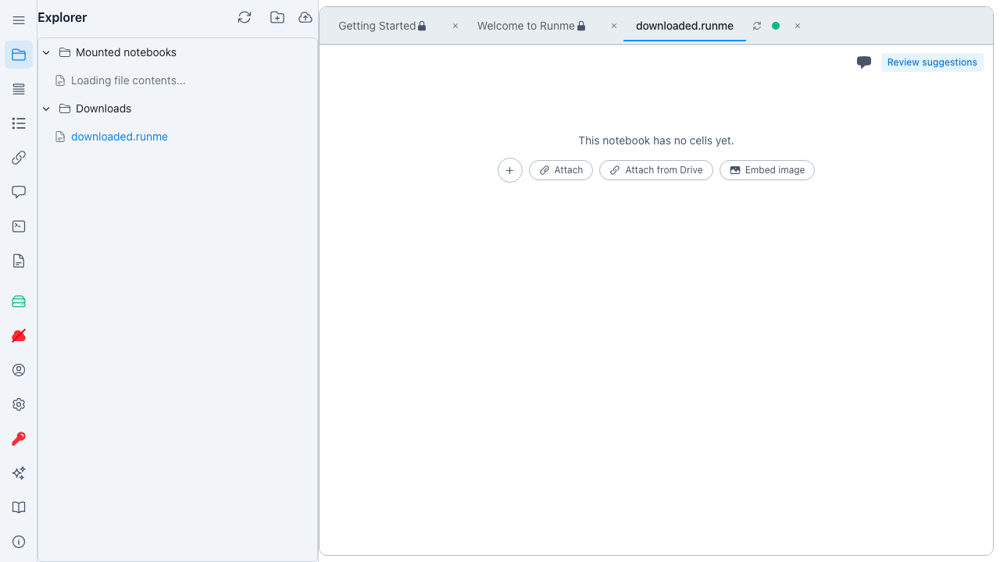

# Mounted local folders for Runme notebooks

**Author** Codex · **Date** November 22, 2026 · **Status** Implemented in draft [PR #454](https://github.com/runmedev/web/pull/454), pending release.

## TL;DR

Download a `.runme` notebook, choose **Open local folder** in Explorer, grant access to its containing directory, and open the notebook. Runme edits a browser-private working copy. Its storage worker merges changes in both directions with the file on disk. Each Explorer folder represents a directory on the local filesystem or Google Drive.

## Motivation

People who can download a shared notebook may have no Google Drive OAuth client configured in Runme. A local download gives them a durable file they can edit and share. The former **Local Notebooks** folder looked like a disk location even though its contents lived inside one browser profile. Retire that folder and the proposed **Browser drafts** replacement. Users creating a notebook from Explorer choose its destination by creating it in a mounted folder.

## Background

Drive already separates the editable notebook from its upstream file. Runme stores the working operation log in the origin private file system (OPFS). IndexedDB records the link between that log and its upstream. A “closed draft” in the earlier proposal meant a notebook whose only copy was in browser storage after its editor tab closed. That matters for recovering existing work. It supplies no reason to introduce another Explorer location. Existing records and local notebook links survive the change. An open legacy notebook can be downloaded from its tab menu.

## Proposal

**Mount identity.** Runme stores the selected directory handle under a workspace ID, a browser-generated key. For example, the upstream address for a file is `fs://workspace/<id>/file/notes.runme`. Two directories named “Downloads” can hold different files. Selecting the same directory again reuses its key so the editor finds the same OPFS history. The browser checks directory identity with `isSameEntry`.

**Open and edit.** Expand a mounted folder to list directories and `.runme` files. Runme reads the file into OPFS on first open. The editor reads and commits operations there, including when directory permission expires. Local mounts offer creation of `.runme` notebooks only. JSON and Jupyter files stay out of local directory listings, creation menus, and periodic synchronization. Existing mirrors retain their compatibility path.

**Synchronize.** On startup and every two minutes while the app runs, the storage worker queues previously opened notebooks in mounted directories, including those with closed tabs. It reads disk changes into OPFS and writes locally committed operations missing from disk. Merging by operation ID makes retries safe. Before replacement, the adapter rechecks the disk revision and checksum under a file lock. Independent desktop applications can still write during the final replacement. A failed write leaves the browser copy available and the tab shows an error. Reconnect from the folder menu after permission loss. Unmount stops scheduled reconciliation. Remounting the same directory reconnects the existing mirrors.

## Alternatives

Keeping a browser-only Explorer folder would preserve two meanings of “local” and would give users another place to create files they cannot find on disk. Writing editor changes directly to the directory would couple editing to permission and bypass the operation log used by Drive. Extending the new sync loop to JSON and Jupyter would require whole-document conflict handling. Limiting local folders to the native operation-log format keeps the merge policy explicit.

## Implementation, testing, and deployment

The Explorer handles folder selection and lists supported entries. The filesystem adapter persists directory identity and guards replacement writes. The storage owner schedules reconciliation independently of Drive authentication and network availability.

The browser regression mounts an isolated test directory, downloads a notebook, places the download in a second directory and mounts it, and opens the copy through Explorer. It then edits another previously materialized notebook outside its editor and checks that the worker picks up the operation with its tab closed. A subsequent browser edit must reach disk alongside the external operation. It substitutes a real browser directory handle for the native picker. Unit tests cover format filtering, identity reuse, disconnected mounts, and interrupted or conflicting writes.

Ship through the normal web release after PR review. On an upgraded profile, confirm an old synthetic root stays hidden and a previously mounted directory reconnects. Verify the native picker and permission-recovery prompt on the release build. Rolling back the UI preserves on-disk files and existing OPFS histories.

## References

- [Draft PR and implementation](https://github.com/runmedev/web/pull/454) — Explorer, filesystem adapter, and storage worker changes.
- [Mounted-folder browser scenario](https://github.com/runmedev/web/blob/codex/local-folder-sync-design/app/test/browser/test-scenario-mounted-notebooks.ts) — reproducible end-to-end checks.
- [Operation-log concurrency](https://github.com/runmedev/web/blob/main/docs-dev/CUJs/runme-operation-log-concurrency.md) — how independent edits converge.
- [Codex session](codex://threads/01a203e9-817c-7081-8b44-8e725976f5f6) — design and review history.
